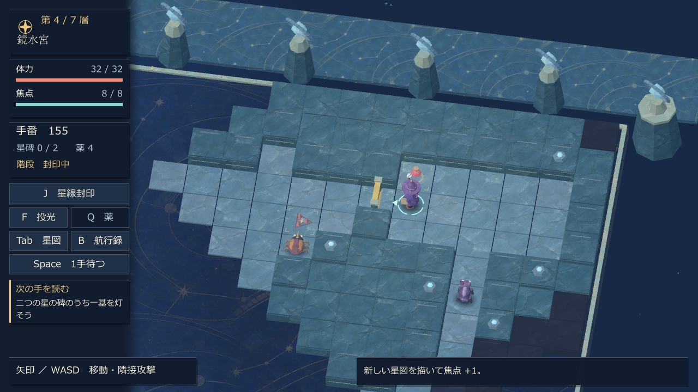

# 星環の迷宮

星の碑を灯しながら、七層の観測所を歩くターン制の探索ゲームです。まず「星盾衛」を選ぶと、盾での接近戦を試せます。「星詠師」は敵の予兆を封じ、「風渡り」は視界と遠矢を使って離れた敵を狙えます。

編成画面の **D「今日の星図」** は、その日の同じ航路条件なら同じ地形が生まれます。日付はPCの現地時刻を使います。職業を替えて同じ迷宮に挑むこともできます。

| 場面 | 操作 |
| --- | --- |
| 探索 | WASD／矢印で1マス移動。敵に向かって進むと攻撃、閉じた扉に向かうと開扉。Spaceで1手待ちます。 |
| 周囲を調べる | Eで星碑・宝箱・階段を調べます。Fの投光は壁の先を照らし、近くの罠を解除します。 |
| 戦闘 | Jで職技、Qで薬。赤く予告されたマスから離れると、敵の狙いを外せます。 |
| 計画 | Tabで戦術図を開き、既知のマスを選んで調べられます。Bの航行録で出会った魔物の標本画と行動を確認できます。 |

各階には星碑がふたつあります。ひとつ灯せば次へ進む条件を満たし、第四層と第七層では番人の撃破も必要です。祭壇で選ぶ遺物は9種類。宝箱からは薬と灯晶が手に入ります。どこまで寄り道して装備を整えるかを選べます。結果画面では同じ地形に再挑戦できます。最奥を踏破すると、暗い薄明航路、射線に注意したい鏡衛航路、扉と罠の多い逆星航路が開きます。

## 手動で調整する

- [Astral.unity](../Assets/Games/Astral/Astral.unity) を開いて再生できます。[Design.asset](../Assets/Games/Astral/Design.asset) で配色、音楽、表紙を編集できます。
- [AstralChart.cs](../Assets/Games/Astral/AstralChart.cs) の `Generate` が部屋、通路と配置を生成します。[AstralJourney.cs](../Assets/Games/Astral/AstralJourney.cs) で職業、職技、遺物、回復量、敵の行動を変更できます。
- [AstralHud.cs](../Assets/Games/Astral/AstralHud.cs) が戦術図や航行録を描きます。[Art](../Assets/Games/Astral/Art) に職業の挿絵、魔物の標本画、音楽と効果音があります。
