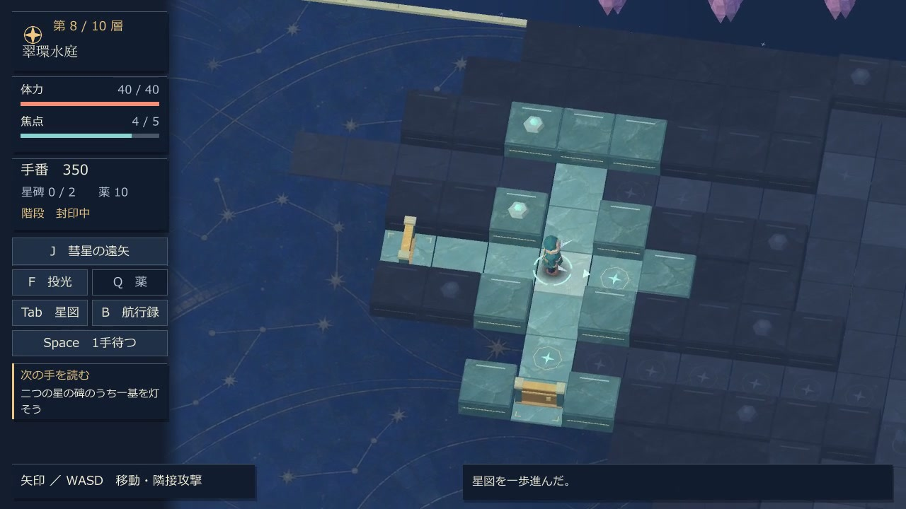

# Cローグライクゲーム

星環の迷宮

自分が一手動くたびに敵も動く、ターン制の迷宮探索です。足元の予兆を見て、攻撃するか、一歩退くか、その場で待つかを考えながら星碑を探します。

**[ブラウザーで遊ぶ](https://kaxic.github.io/shiosai-astral-labyrinth/)** ・ [A〜Fのゲーム一覧](https://kaxic.github.io/shiosai-game-library/#C)

[実際のプレイ映像を見る](https://kaxic.github.io/shiosai-astral-labyrinth/media/demo.mp4)

## 最初にすること

編成で職業を選んで出発します。初めは接近戦が得意な「星盾衛」が扱いやすいでしょう。矢印で1マスずつ進み、敵のいるマスに踏み込むと攻撃、閉じた扉に進むと開扉になります。

## 遊びの流れ

各階で星碑を一つ灯すと、先へ進む条件の一つを満たします。宝箱や祭壇へ寄るか、階段を急ぐかは自分次第。戦術図で通路を確かめ、投光で近くの罠を払いながら進みましょう。

## 目指すもの

第4・第7・第10層では番人を倒す必要があります。十層を踏破した先には、暗さや罠の配置が違う三つの航路があります。「今日の星図」では同じ日・同じ条件の迷宮に別の職業でも挑めます。

[遊び方と手動で拡張する方法](Guides/Astral.md)

## Unityで開く

Unity Hubでこのフォルダーを追加し、Unity 6000.3.28f1で `Assets/Games/Astral/Astral.unity` を開いて再生します。

Web版は Web Build Support を追加し、Unity の **Shiosai → Build browser game** から再ビルドできます。出力先は `docs` です。

[拡張版の内容](更新内容.md) ・ [Windows版をダウンロード](https://github.com/kaxic/shiosai-astral-labyrinth/releases/latest)
